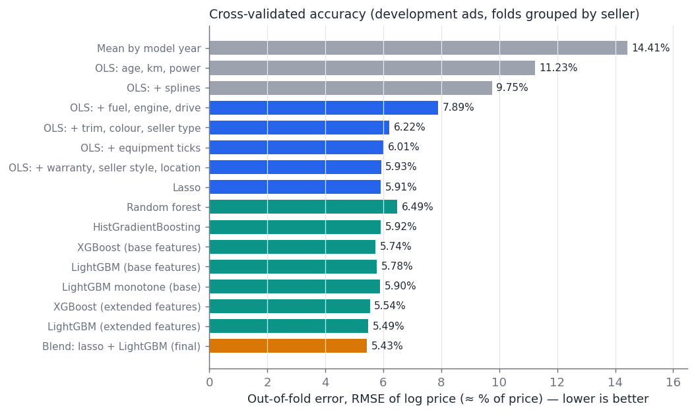
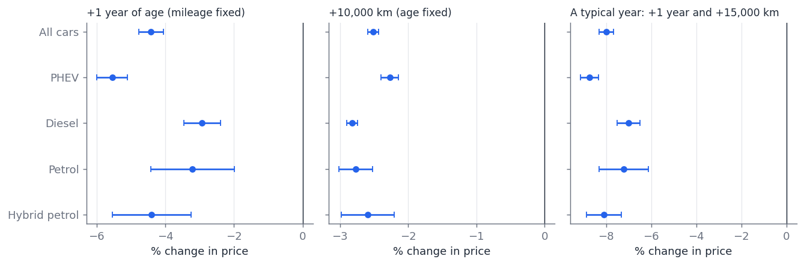
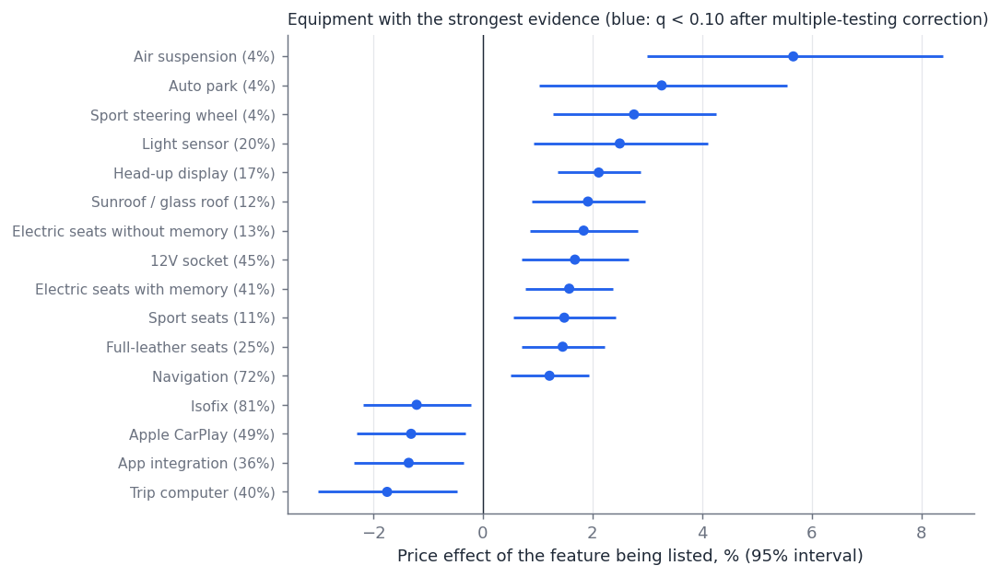

# Hedonic price model for used car listings

How much does an extra year of age or an extra 10,000 km cost, what is a given used car *worth*, and how does that compare with its asking price?
This repository contains the analysis pipeline for 2,995 used, automatic-gearbox car listings (model year 2016 and later) from an online marketplace,
snapshot 16–17 October 2026: a systematic model comparison, dealer effects, inference, robustness checks and the documentation of every experiment.

> **Data note.** The raw listings and the code that collected and parsed them are **not** included. The repository ships an **anonymised
> extract** in the format the pipeline reads (`data/example_table.csv`, documented in [`model/INPUT_FORMAT.md`](model/INPUT_FORMAT.md)) and the same data as a spreadsheet with the
> model's output (`spreadsheet/`). Make, model, engine codes, registration and chassis numbers, photos, links, titles, exact dates, seller names, coordinates and the country were removed;
> trim labels are invented; IDs are random. You can run the pipeline on your own table in the same format.

## Headline results

| | |
|---|---|
| Accuracy of the fair price (typical error, cross-validated by seller) | **5.4%** of price (mean absolute error 13 800 price units) |
| Same on a hold-out of 478 ads touched once | **5.2%** (14 700) |
| One more year of age at the same mileage | **−4.4%** (plug-in hybrids −5.6%, diesels −2.9%) |
| One more 10 000 km at the same age | **−2.5%** |
| A typical year of ownership (+1 year, +15 000 km) | **≈ −8%** |
| Trim level vs the base trim ("Basic"; same age, mileage, engine) | Sport +15%, Elite +13%, Executive +12%, Comfort +10%, Prestige +9%, Classic +5% |
| Equipment beyond trim | mostly +1% to +3% (head-up display, glass roof, electric seats, navigation); air suspension +5.7%; many effects not distinguishable from zero |
| Warranty | no price premium found |
| Dealer effect | independent dealers price ±4% around comparable cars, branches within a dealer group ±2%, no group-level effect; knowing the dealer cuts the error by 6–8% |

Age is modelled with a flexible spline rather than a line; year dummies fit no better (experiment E12). At fixed mileage the price falls fastest in years 3–6
(about 5–7% a year) and more slowly before and after; adding the usual mileage gives a total yearly loss of about 6% in the first two years and about 11% in years 4–5.

The headline numbers come from the full private table; the anonymised example table is reduced (rounded values, no coordinates or titles, different random folds), so rerunning on it
gives similar but not identical numbers.

## How it was done (short)

- **Target and validation.** Log asking price (VAT included). 16% of sellers are locked away as a hold-out; the rest is cross-validated **grouped by seller**, so a model is
  never tested on a dealer it has seen. Hyper-parameters are tuned in an inner grouped CV. The hold-out is touched once.
- **Models compared.** Staged OLS with splines (age/mileage → fuel/engine → trim → equipment → warranty/location), ridge/lasso/elastic net, random forest, HistGradientBoosting,
  LightGBM (also with monotone constraints), XGBoost, and a 50/50 blend of lasso and LightGBM (final). Extra features tested under a decision rule fixed in advance (experiment E11).
- **Dealer effects.** Empirical-Bayes (shrunken) dealer and dealer-group premiums from out-of-fold residuals, evaluated leave-one-ad-out.
- **Inference.** Seller-clustered OLS with delta-method and cluster-bootstrap intervals; SHAP for the tree model; 13 robustness variants.
- **Documentation.** Every experiment is logged with the expectation written *before* running it and the result afterwards, including the misses:
  [`model/EXPERIMENT_LOG.md`](model/EXPERIMENT_LOG.md). The plan and its changes: [`model/PLAN.md`](model/PLAN.md). Cleaning rules and counts:
  [`model/CLEANING_LOG.md`](model/CLEANING_LOG.md). Every column: [`model/DATA_DICTIONARY.md`](model/DATA_DICTIONARY.md).







## Repository layout

```
model/
  PLAN.md  EXPERIMENT_LOG.md  CLEANING_LOG.md  DATA_DICTIONARY.md  INPUT_FORMAT.md
  src/                 numbered scripts 00 ... 12 and lib.py
  results/             aggregate results (CV tables, effects, robustness) and figures
data/example_table.csv anonymised modelling table (the pipeline's input)
spreadsheet/           anonymised ad-level extract with the model's output (Excel)
```

## Run it

Python 3.12 and the packages in `requirements.txt` (pinned versions; numpy 2.x breaks several of them).

```bash
pip install -r requirements.txt
cd model/src
python 00_validate_table.py                       # checks the input table
python 01_split.py                                # frozen hold-out and grouped folds
python 02_ols_stages.py                           # baselines and staged OLS
python 03_zoo.py                                  # linear and tree models with nested CV (about 15 minutes)
python 04_final_fit.py lasso lightgbm             # blend, one-time hold-out check
python 05_dealer.py blend                         # dealer effects
python 06_inference.py && python 06b_shap.py lightgbm
python 07_fairvalue.py && python 08_robustness.py && python 09_extras.py && python 12_age_form.py && python 10_figures.py
```

To use your own data, produce a table in the format of `data/example_table.csv` and set `MODEL_TABLE=/path/to/table.csv`.
Optional: `ADS_OF_INTEREST=123,456` makes `06b_shap.py`, `07_fairvalue.py` and `10_figures.py` examine particular ads.
All scripts write to `model/results/`; fixed seeds are in `lib.py`.

## Limitations

- **Asking prices, not transaction prices;** cars that sell quickly disappear from the data.
- **Condition is invisible:** damage, service history, wear. The largest apparent bargains are the most likely to have a reason.
- **Equipment is measured from sellers' lists:** an unticked box means *not listed*, which biases effects towards zero; trim bundles cannot be separated.
- **Trim comes from free-text titles** (17% state none). Few petrol, hybrid-petrol and very-high-mileage cars.
- **One snapshot.** Not advice to buy or sell.

## License

Code: MIT (see `LICENSE`). The data extract is a derived, anonymised file provided as-is for illustration; the underlying listings belong to their authors and the marketplace.
